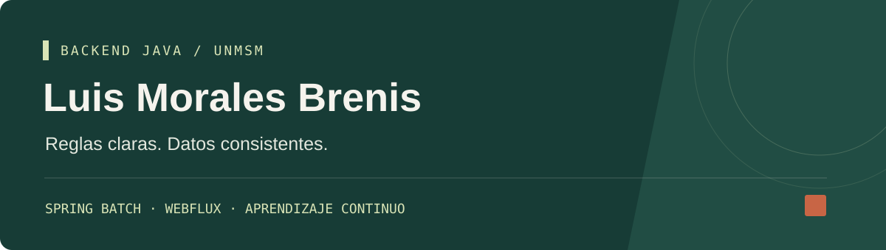

  

  
  

## Hola, soy Luis

Estudio **Ingeniería de Software en la Universidad Nacional Mayor de San Marcos** y estoy en búsqueda de **prácticas preprofesionales en desarrollo backend Java**.

Me interesa construir servicios que resuelvan reglas de negocio concretas: validar información, conservar su historial y mantener datos consistentes cuando hay reintentos o cambios simultáneos.

Actualmente desarrollo proyectos con **Java y Spring Boot**, trabajando con procesamiento batch y APIs reactivas. Organizo el trabajo mediante especificaciones y utilizo asistencia de IA como parte de mi aprendizaje, con revisión del código y validación local.

## Proyectos destacados

### Preliquidación mensual por horas

**Del archivo CSV a una versión mensual con historial, PDF y correo confirmado.**

`Java 21` · `Spring Boot` · `Spring Batch` · `PostgreSQL` · `JasperReports`

- Recepción de archivos con validación estructural, clasificación de filas y motivos de rechazo.
- Cálculos monetarios con `BigDecimal` y activaciones explícitas que conservan las versiones anteriores.
- Reportes PDF vigentes e históricos y correo con revisión, confirmación y trazabilidad del documento.

**Estado:** validado localmente con pruebas automatizadas y un recorrido manual documentado. Prepara información para pagos; no ejecuta transferencias.

[Ver código y documentación →](https://github.com/LuisBrenis3011/batch-report-generator) · [Conocer el proyecto →](https://portfolio-web-gamma-tan.vercel.app/proyectos/preliquidacion.html)

---

### Eats Hub

**Catálogo de restaurantes, disponibilidad y gestión de reservas.**

`Java 21` · `Spring Boot` · `Spring WebFlux` · `MongoDB` · `Redis` · `JWT`

- Consulta de restaurantes y disponibilidad de mesas y turnos.
- Permisos por identidad, idempotencia y control de versiones mediante ETag.
- Recorrido local con datos ficticios: confirmar, consultar, modificar y cancelar una reserva.

**Estado:** en desarrollo. El recorrido de reservas fue comprobado manualmente, incluidos replay, acceso de otro cliente, versión obsoleta y persistencia tras reiniciar. La migración operativa y sus aprobaciones siguen pendientes.

[Ver código y documentación →](https://github.com/LuisBrenis3011/Reservation-SpringWebFlux) · [Conocer el proyecto →](https://portfolio-web-gamma-tan.vercel.app/proyectos/eats-hub.html)

## Tecnologías que uso en estos proyectos

  
  
  
  

  
  
  

  
  
  
  

## Mi enfoque

**Entender el problema → definir reglas → implementar → comprobar el comportamiento.**

En los repositorios documento las decisiones técnicas, los resultados observados y los límites actuales. Sigo aprendiendo sobre transacciones, concurrencia y diseño de APIs a través de estos proyectos.

  <a href="https://portfolio-web-gamma-tan.vercel.app/#contacto">Conversemos</a> · Abierto a prácticas preprofesionales en backend Java

